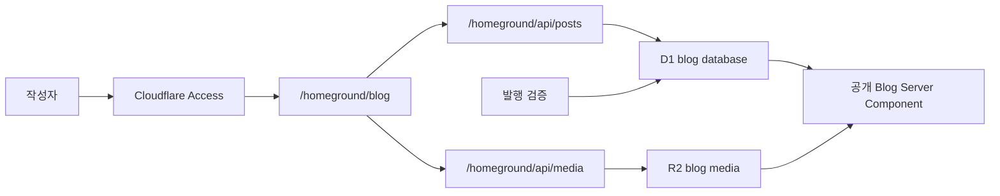

# Homeground 블로그 관리 설계

## 승인 상태

- 작업 브랜치: `codex/personal-site-hub`
- 상태: 제안 완료, 구현 승인 대기
- 플랫폼: [Cloudflare 플랫폼 전환 설계](./2026-08-16-cloudflare-platform-design.md)

사용자가 구현을 명시적으로 승인하기 전에는 개발 전용 route 공개, D1/R2 리소스 생성, 데이터 이전과 애플리케이션 코드 변경을 하지 않는다.

## 현재 자산

현재 `/blog-editor`에는 다음 기능이 이미 구현되어 있다.

- canonical blog JSON 목록과 새 글 생성
- 제목, slug, 요약, 공개 상태, 날짜, 태그와 cover metadata 편집
- 제한된 BlockNote schema 기반 본문 편집
- desktop 40:60 편집·프리뷰, mobile tab 전환
- `sessionStorage` 자동 저장과 손상 초안 복구
- Zod schema와 asset 검증 후 JSON 다운로드
- 공개 글 slug 변경 방지
- 교체 가능한 `AssetProvider` 경계

운영 Homeground로 전환할 때 편집 UI와 공개 renderer를 다시 만들 필요는 없다. 개발 전용 route와 filesystem loader를 인증된 route, 원격 repository와 R2 provider로 교체한다.

## 가능한 운영 모델

| 모델 | 글 원본 | 발행 방식 | 장점 | 제약 |
| --- | --- | --- | --- | --- |
| A. 이미지 어드민 | Git JSON | JSON 다운로드 후 수동 commit | 가장 빠르고 안전함 | 원격 저장·발행이 아님 |
| B. Git 발행 CMS | Git JSON | Worker가 GitHub commit/PR 생성 | Git 이력과 사전 렌더링 유지 | GitHub App/token, 배포 대기와 실패 처리가 필요 |
| C. D1 CMS | D1 | D1 draft를 published snapshot으로 전환 | 진짜 웹 어드민, 저장·발행이 즉시 동작 | 공개 블로그 data source 이전과 동적 route 검증 필요 |
| D. D1 draft + Git 발행 | D1 + Git | draft는 D1, 발행은 Git PR | 복구성과 Git 이력 모두 확보 | 동기화 상태가 두 개라 초기 구조로 과함 |

권장 최종 모델은 **C. D1 CMS**다. static export가 필수가 아니고 Cloudflare를 기능 플랫폼으로 사용하려는 목표에 가장 잘 맞는다. 다만 첫 배포는 A 모델 수준의 `/homeground/blog` + Access + R2 업로드를 먼저 완성한 뒤 D1 저장과 발행을 다음 milestone로 붙인다. 이렇게 하면 이미지 업로드 요구를 먼저 검증하고 콘텐츠 이전 위험을 분리할 수 있다.

## 목표 구조

Cloudflare Access는 `/homeground`와 모든 하위 path를 하나의 application policy로 보호하고 Worker는 Access JWT의 issuer, audience와 만료를 다시 검증한다. 공개 사이트와 같은 Next.js Worker에 route를 두되, Homeground client bundle은 공개 route에서 import하지 않는다. Access는 path 단위 application policy를 지원한다.

- [Access 경로 정책](https://developers.cloudflare.com/cloudflare-one/access-controls/policies/app-paths/)
- [Access JWT 검증](https://developers.cloudflare.com/cloudflare-one/access-controls/applications/http-apps/authorization-cookie/validating-json/)

## Homeground 정보 구조

| URL                     | 역할                                                |
| ----------------------- | --------------------------------------------------- |
| `/homeground`           | 콘텐츠 상태, 최근 수정, 빠른 작업                   |
| `/homeground/blog`      | draft/published 목록, 검색과 새 글                  |
| `/homeground/blog/new`  | 새 글 작성                                          |
| `/homeground/blog/[id]` | 기존 글 편집, preview, 발행                         |
| `/homeground/media`     | 업로드된 이미지 검색·복사·참조 확인, 후속 milestone |

Homeground는 sitemap과 공개 navigation에서 제외하고 route layout에 `noindex, nofollow`를 지정한다. `robots.txt`에는 경로를 별도로 적지 않는다. 경로 이름은 공개 Studio와 짝을 이루는 브랜딩이며 보안 비밀로 취급하지 않는다.

현재 query-string 기반 편집 route는 static export 제약 때문에 선택되었다. OpenNext 전환 뒤에는 안정적인 ID dynamic segment를 사용한다. slug는 공개 URL이고 ID는 어드민 identity이므로 서로 분리한다.

## 서버 경계

UI는 Server Action에 직접 결합하지 않고 versioned Route Handler를 사용한다. 기존 로컬 editor adapter와 E2E harness를 유지하고 향후 외부 클라이언트에서도 사용할 수 있기 때문이다.

| Method | Route                                | 역할                                 |
| ------ | ------------------------------------ | ------------------------------------ |
| `GET`  | `/homeground/api/posts`              | 글 목록과 상태 조회                  |
| `POST` | `/homeground/api/posts`              | 새 draft 생성                        |
| `GET`  | `/homeground/api/posts/[id]`         | 편집용 document 조회                 |
| `PUT`  | `/homeground/api/posts/[id]`         | version 확인 후 draft 저장           |
| `POST` | `/homeground/api/posts/[id]/publish` | 전체 검증 후 published snapshot 생성 |
| `POST` | `/homeground/api/media`              | R2 업로드와 공개 URL 반환            |

모든 mutation은 exact origin, Access identity, body size와 Zod schema를 확인한다. 응답은 `schemaVersion`을 포함하고 오류는 field issue와 HTTP status를 함께 반환한다.

## D1 데이터 모델

### `blog_posts`

- `id`: UUID primary key
- `slug`: unique, 발행 후 변경 금지
- `status`: `draft | published`
- `title`, `summary`, `published_at`, `updated_at`
- `tags_json`, `cover_image_json`, `blocks_json`
- `version`: optimistic concurrency integer
- `created_at`, `last_saved_at`

### `blog_revisions`

- `id`, `post_id`, `version`
- `snapshot_json`: 검증이 끝난 전체 `BlogPost`
- `created_at`, `created_by`
- `reason`: `autosave | publish | restore`

### `media_assets`

- `id`, `r2_key`, `public_url`
- `content_type`, `size`, `etag`
- `created_at`, `created_by`

본문 JSON을 현재 `BlogPost` schema와 같은 envelope로 보존해 기존 BlockNote editor와 공개 renderer를 재사용한다. 검색·목록·unique constraint에 필요한 metadata만 열로 분리한다.

## 편집과 저장

- 입력 후 800~1,500 ms debounce로 draft를 자동 저장한다.
- 마지막 서버 `version`을 `PUT`에 포함하고 일치할 때만 갱신한다.
- 다른 tab이나 오래된 화면의 저장은 409 conflict로 차단하고 비교·새로고침 선택을 제공한다.
- `sessionStorage`는 제거하지 않고 네트워크 실패 시 복구용 local cache로 역할을 낮춘다.
- 저장 상태를 `저장 중`, `저장됨`, `오프라인 변경`, `충돌`로 구분한다.
- preview는 현재 draft를 즉시 렌더링하고 공개 renderer와 같은 schema를 사용한다.

## 이미지 업로드

BlockNote image 삽입과 cover image 선택에서 같은 `R2AssetProvider`를 사용한다. 업로드가 성공하면 API가 반환한 최종 HTTPS URL과 asset ID를 draft에 기록한다. 초기 schema compatibility를 위해 기존 `provider: "public"`을 `provider: "r2"`까지 허용하도록 version migration을 추가한다.

이미지는 R2에서 public-read, Worker에서 authenticated-write 구조로 운영한다. 미참조 이미지 삭제는 즉시 구현하지 않는다. 나중에 `media_assets`와 draft/published snapshot 참조를 모두 확인한 뒤 soft delete와 일정 기간 후 정리 작업을 추가한다.

## 발행

1. 현재 version의 draft를 다시 읽는다.
2. `BlogPost` schema, slug uniqueness, 발행일과 모든 R2 asset 존재 여부를 검증한다.
3. 전체 document를 `blog_revisions`에 snapshot으로 기록한다.
4. 같은 transaction에서 `blog_posts.status`를 `published`로 바꾼다.
5. 성공 후 공개 URL과 새 version을 반환한다.

공개 blog route는 `published` row만 읽고 현재 static renderer로 HTML을 만든다. BlockNote runtime은 계속 공개 bundle에 포함하지 않는다. 초기에는 요청 시 D1을 읽는 Server Component로 구현하고, OpenNext Free 플랜의 CPU와 요청 한도를 측정한다. 트래픽이 커질 때만 R2 incremental cache와 revalidation을 추가한다.

D1 Free 한도는 일 500만 rows read, 10만 rows written으로 개인 블로그의 자동 저장과 공개 조회에 충분하다. 동적 요청은 Workers Free의 일 10만 요청, CPU 10 ms 한도를 함께 사용한다. [Workers와 D1 가격](https://developers.cloudflare.com/workers/platform/pricing/)

## 기존 글 이전

- repository의 canonical JSON을 schema 검증 후 D1 migration seed로 변환한다.
- 기존 ID, slug, 날짜와 block ID를 그대로 유지한다.
- 각 글의 최초 revision에 원본 JSON snapshot을 기록한다.
- staging에서 목록, 상세, RSS와 sitemap을 기존 출력과 비교한다.
- 전환이 승인될 때까지 filesystem loader와 GitHub Pages 배포를 제거하지 않는다.
- D1 전환 후에도 관리 화면에서 전체 JSON export를 제공한다.

## 단계별 범위

### Milestone 1. 운영 가능한 이미지 Homeground

- `/homeground/blog` 운영 route와 Access
- 기존 editor UI 승격
- R2 이미지 업로드와 URL 삽입
- session draft와 JSON export 유지

### Milestone 2. D1 저장·발행

- D1 repository와 migration
- 서버 자동 저장, 충돌 감지와 revisions
- 직접 발행·비공개 전환
- 공개 목록·상세·RSS·sitemap의 D1 read adapter

### Milestone 3. 운영 편의

- media library와 참조 확인
- revision 비교·복원
- 예약 발행, 검색, 사용량·오류 dashboard

## 완료 조건

- 인증되지 않은 사용자는 Homeground HTML과 API에 접근할 수 없다.
- 기존 글을 손실 없이 열고 편집·preview할 수 있다.
- 이미지 업로드 후 반환 URL이 draft와 공개 글에서 렌더링된다.
- 자동 저장 충돌이 기존 변경을 조용히 덮어쓰지 않는다.
- 발행은 schema와 asset 검증이 모두 성공할 때만 원자적으로 완료된다.
- 공개 bundle에는 BlockNote editor runtime과 Homeground 코드가 포함되지 않는다.
