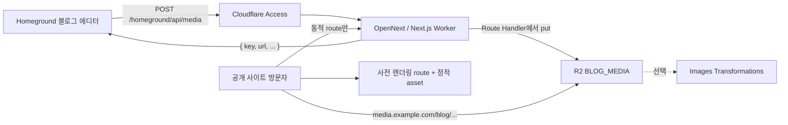

# Cloudflare 플랫폼 전환 설계

## 승인 상태

- 작업 브랜치: `codex/personal-site-hub`
- 상태: 제안 완료, 구현 승인 대기
- 기준일: 2026-08-16
- 개인 사이트 설계: [종합 개인 사이트 허브 설계](./2026-08-16-personal-site-hub-design.md)
- Homeground 설계: [Homeground 블로그 관리 설계](./2026-08-16-blog-admin-design.md)

사용자가 구현을 명시적으로 승인하기 전에는 Cloudflare 리소스 생성, 배포 설정 변경, 패키지 업데이트와 애플리케이션 코드 변경을 하지 않는다.

## 결정 요약

Next.js의 `output: "export"` 제약은 제거한다. `@opennextjs/cloudflare` adapter로 App Router 애플리케이션 전체를 한 개의 Cloudflare Worker에 배포한다. 공개 홈, 포트폴리오, 블로그 글처럼 요청 시점 데이터가 필요 없는 route는 계속 build-time에 사전 렌더링하고, `/homeground/api/media`와 향후 Homeground 기능만 동적으로 실행한다.

Cloudflare의 Next.js adapter는 App Router, Route Handlers, React Server Components, SSG, SSR, ISR와 Server Actions를 지원한다. 따라서 현재 정적 사이트의 빠른 공개 경로를 유지하면서 별도 API 프로젝트 없이 R2 binding을 Next Route Handler에서 사용할 수 있다.

- [Cloudflare Workers의 Next.js 지원](https://developers.cloudflare.com/workers/framework-guides/web-apps/nextjs/)
- [기존 Next.js 앱의 OpenNext 전환](https://opennext.js.org/cloudflare/get-started)

## 목표 구조



JavaScript, CSS, font와 일반 이미지 같은 정적 asset은 무료·무제한 경로로 제공한다. 공개 HTML은 가능한 한 build-time에 사전 렌더링하고 동적 렌더링은 명시적으로 필요한 route에만 허용한다. 이 구성은 static export가 아니므로 Next.js Route Handler와 Cloudflare binding을 같은 코드베이스에서 사용할 수 있다.

## 배포 방식 비교

| 방식 | 장점 | 제약 | 판단 |
| --- | --- | --- | --- |
| Next static export + 별도 API Worker | 공개 HTML까지 완전 정적, 가장 단순한 비용 모델 | 앱과 API의 dev·deploy·type 경계가 나뉨 | Free 한도 검증 실패 시 fallback |
| OpenNext full-stack Worker | Next Route Handler, RSC와 향후 SSR/ISR 사용 가능, 한 번에 배포 | Free 플랜의 3 MiB bundle·10 ms CPU 한도 검증 필요 | **권장** |
| Cloudflare Pages | Git 연동이 단순하고 static export 지원 | 신규 기능의 중심이 Workers이며 Functions는 결국 Workers 과금 | 신규 전환 대상으로 미채택 |

초기 spike에서 압축 Worker가 3 MiB를 넘거나 대표 동적 요청의 CPU가 지속적으로 10 ms를 넘으면 첫 번째 방식으로 되돌린다. Free 플랜은 동적 Worker 요청 일 100,000회, 요청당 CPU 10 ms, memory 128 MB, 압축 Worker 3 MiB를 제공하며 정적 asset 요청은 무료·무제한이다. 자세한 수치는 [Workers 가격](https://developers.cloudflare.com/workers/platform/pricing/)과 [Workers 한도](https://developers.cloudflare.com/workers/platform/limits/)를 따른다.

## 서비스 선택

| 서비스 | 채택 | 역할 | 무료 티어 판단 |
| --- | --- | --- | --- |
| Workers + OpenNext | 채택 | Next.js SSG·동적 route·Route Handler의 단일 배포 | 정적 asset은 무료·무제한. 동적 요청은 Workers Free 한도 사용 |
| R2 Standard | 채택 | 블로그 원본 이미지 저장·공개 | 월 10 GB 저장, Class A 100만, Class B 1,000만 작업, 인터넷 egress 무료 |
| Cloudflare Access | 채택 | 업로드 API를 작성자 본인에게만 공개 | Zero Trust Free는 최대 50명 사용자에 적합 |
| Images Transformations | 선택 | 썸네일·본문·OG용 리사이즈/포맷 최적화 | 외부 저장 이미지 기준 월 5,000개 고유 변환 무료 |
| Turnstile | 보류 | 향후 공개 문의·댓글의 봇 방지 | 무료지만 관리자 전용 업로드에는 Access로 충분 |
| D1 | Homeground 2단계 | 원격 draft, published snapshot, revision | 이미지 업로드만 구현하는 1단계에는 불필요 |
| KV | 보류 | 읽기 중심 설정·캐시 | 이미지 업로드 URL 반환에는 불필요 |
| Queues | 보류 | 비동기 이미지 후처리 | 초기 업로드 규모에서는 동기 저장으로 충분 |
| Cloudflare Images 저장소 | 미채택 | 관리형 이미지 저장·전송 | 저장·전송이 유료이므로 R2보다 초기 비용이 큼 |

무료 한도와 과금 기준은 [Workers 가격](https://developers.cloudflare.com/workers/platform/pricing/), [R2 가격](https://developers.cloudflare.com/r2/pricing/), [Images 가격](https://developers.cloudflare.com/images/pricing/), [Turnstile 플랜](https://developers.cloudflare.com/turnstile/plans/)을 기준으로 한다.

## 이미지 업로드 계약

### 초기 방식: Worker 프록시 업로드

1. 에디터가 파일 원본을 `POST /homeground/api/media` 요청 본문으로 전송한다.
2. Cloudflare Access와 Worker가 사용자를 검증한다.
3. Worker가 크기, Content-Type과 파일 시그니처를 확인한다.
4. Worker가 요청 스트림을 R2 binding으로 저장한다.
5. 저장 성공 후 최종 공개 URL을 JSON으로 반환한다.
6. 기존 BlockNote image block이 URL을 canonical blog JSON에 기록한다.

초기 개인 사이트 트래픽에서는 이 방식이 가장 단순하다. S3 서명 라이브러리와 임시 자격 증명이 필요 없고, 업로드 한 건이 Worker Free 요청 한 건 정도를 사용한다. 업로드 빈도나 파일 크기가 커지면 Worker는 짧은 만료 시간의 presigned PUT URL만 발급하고 브라우저가 R2로 직접 전송하는 방식으로 바꾼다.

R2는 [Worker binding 업로드](https://developers.cloudflare.com/r2/objects/upload-objects/)와 [presigned URL](https://developers.cloudflare.com/r2/api/s3/presigned-urls/)을 모두 지원한다. presigned URL은 R2 S3 API 도메인에서만 동작하므로 custom domain 공개 URL과 혼동하지 않는다.

### 요청 제한

- 허용 형식: JPEG, PNG, WebP, AVIF
- 초기 최대 크기: 5 MiB
- SVG와 애니메이션 GIF는 스크립트·용량 위험을 줄이기 위해 제외
- 클라이언트 Content-Type만 믿지 않고 magic bytes를 함께 검증
- 원본 파일명 대신 `blog/YYYY/MM/<uuid>.<ext>` 형식의 불변 key 사용
- 동일 key 덮어쓰기 금지
- CORS는 로컬 에디터와 승인된 운영 origin만 정확히 허용
- 저장 객체에 `Cache-Control: public, max-age=31536000, immutable` 적용

### 성공 응답

```json
{
  "schemaVersion": 1,
  "key": "blog/2026/08/0198...e4.webp",
  "url": "https://media.example.com/blog/2026/08/0198...e4.webp",
  "contentType": "image/webp",
  "size": 184320,
  "etag": "..."
}
```

업로드가 실제로 R2에 성공하기 전에는 URL을 반환하지 않는다. 검증 실패는 400, 인증 실패는 401/403, 크기 초과는 413, key 충돌은 409로 구분한다.

## 공개 URL과 도메인

운영 환경은 `media.<보유 도메인>`을 R2 bucket custom domain으로 연결하는 구성이 권장된다. R2의 `r2.dev` URL은 개발용이며 가변 rate limit이 있어 운영 배포에 사용하지 않는다. custom domain을 사용하면 Cloudflare Cache, WAF·Rules와 분석도 함께 사용할 수 있다.

- [R2 public bucket과 custom domain](https://developers.cloudflare.com/r2/platform/limits/)
- [R2와 Cloudflare Cache](https://developers.cloudflare.com/cache/interaction-cloudflare-products/r2/)

현재 `dogeol.github.io`는 GitHub 소유 도메인의 하위 도메인이므로 Cloudflare zone으로 가져올 수 없다. 별도 보유 도메인이 없다면 첫 배포는 `<worker>.workers.dev`에서 사이트와 `/media/*` 프록시를 함께 제공할 수 있지만, 이미지 조회마다 Worker 무료 요청 한도를 사용한다. 운영 전에는 개인 도메인을 Cloudflare DNS에 연결하는 편이 안정적이다.

## 인증

업로드 API는 공개 secret을 프론트엔드에 심지 않고 Cloudflare Access로 보호한다. 허용 identity는 작성자의 GitHub, Google 또는 email identity 하나로 제한한다. Worker도 `Cf-Access-Jwt-Assertion`을 검증해 Access 설정 우회와 잘못된 audience를 차단한다.

- [Access 경로 정책](https://developers.cloudflare.com/cloudflare-one/access-controls/policies/app-paths/)
- [Worker에서 Access JWT 검증](https://developers.cloudflare.com/cloudflare-one/access-controls/applications/http-apps/authorization-cookie/validating-json/)

초기에는 기존 로컬 전용 블로그 에디터가 배포된 Next.js Route Handler를 호출한다. Access 로그인과 CORS에 localhost origin을 등록한다. 운영 편집 화면은 `/homeground/blog`에 두고 `/homeground`의 모든 하위 path를 Access로 보호한다.

## 무료 티어 예상

예시로 이미지 1,000개, 평균 2 MiB, 월 조회 100,000회를 가정한다.

| 항목                  |                           예상 사용량 | 무료 한도 대비                  |
| --------------------- | ------------------------------------: | ------------------------------- |
| R2 저장               |                         약 2 GB-month | 10 GB-month 이내                |
| R2 쓰기               |                      약 1,000 Class A | 100만 이내                      |
| R2 읽기               |                    약 100,000 Class B | 1,000만 이내                    |
| 업로드 Worker         |               약 1,000 requests/month | 일 100,000 requests 이내        |
| 정적 asset            |                    트래픽에 따라 증가 | 정적 요청 무료·무제한           |
| 사전 렌더링·동적 HTML |          방문당 최대 1 Worker request | 일 100,000 requests 이내를 목표 |
| 이미지 변환           | 1,000장 × 3 규격 = 3,000 unique/month | 5,000 이내                      |
| 인터넷 egress         |                        약 200 GB 가정 | R2 egress 무료                  |

Images Transformations는 조회 횟수가 아니라 원본과 변환 규격의 고유 조합을 센다. 무료 한도를 넘으면 새 변환이 실패할 수 있으므로 처음에는 본문, 썸네일, OG의 최대 세 규격으로 제한한다. 완전 무료 운영을 우선하면 업로드 전에 WebP/AVIF로 압축하고 원본 URL만 사용한다.

## 기술 스택 업그레이드 전략

2026-08-16의 `pnpm outdated` 결과를 기준으로 현재 스택은 이미 비교적 최신이다. 런타임과 편집기 의존성을 한 번에 올리지 않고 다음 묶음별로 회귀 검증한다.

| 묶음 | 현재 | 제안 | 방침 |
| --- | --- | --- | --- |
| Next 묶음 | Next·MDX·ESLint config 16.2.10 | 16.3.1 | 세 패키지를 같은 버전으로 함께 상승 |
| React 묶음 | React·React DOM 19.2.7 | 19.2.8 | 타입 패키지와 함께 상승 |
| Tailwind 묶음 | Tailwind·PostCSS plugin 4.3.2 | 4.3.3 | visual regression 확인 |
| BlockNote 묶음 | 0.51.4 | 0.54.0 | 네 패키지를 함께 올리고 editor E2E 우선 검증 |
| 테스트·도구 | Playwright 1.61.1 등 | 호환되는 minor/patch | 공개 route와 editor harness 검증 |
| major 후보 | TypeScript 7, ESLint 10, Motion 13, jsdom 30 등 | 별도 후속 작업 | migration guide와 plugin 호환성 확인 전 보류 |

Cloudflare 도입을 위해 `@opennextjs/cloudflare`, Wrangler와 binding 타입 생성을 추가한다. 로컬 `next dev`에서도 Cloudflare binding을 사용할 수 있게 adapter 초기화를 적용한다. Node.js compatibility가 제공되더라도 신규 Route Handler는 Web API와 R2 binding을 우선 사용해 runtime 종속성을 줄인다.

ISR은 첫 배포에 사용하지 않는다. OpenNext에서 time-based revalidation을 사용하면 R2 incremental cache와 Queue 역할의 Durable Object가 추가되며, on-demand tag revalidation에는 D1 또는 Durable Object가 필요하다. 현재 Git 기반 게시 흐름은 배포 시 재생성으로 충분하므로 추가 binding과 무료 한도 복잡도를 만들지 않는다. 필요해질 때 [OpenNext caching 구성](https://opennext.js.org/cloudflare/caching)을 별도 승인한다.

## 비목표

- 모든 공개 페이지를 요청마다 SSR하지 않는다.
- 블로그 게시물 원본을 D1로 이전하지 않는다.
- 이미지 삭제·폴더 관리 UI를 첫 단계에 넣지 않는다.
- Cloudflare Images 유료 저장소에 원본을 이관하지 않는다.
- custom domain 구매나 Cloudflare account 리소스 생성은 별도 승인 없이 실행하지 않는다.

## 완료 조건

- 기존 공개 route, 사전 렌더링 결과와 URL이 유지된다.
- OpenNext Worker가 Free 플랜의 압축 bundle 3 MiB와 대표 요청 CPU 10 ms 한도를 충족한다.
- `/homeground/api/media`는 인증된 JPEG/PNG/WebP/AVIF만 R2에 저장한다.
- 업로드 성공 응답의 URL을 공개 브라우저에서 읽을 수 있다.
- 블로그 에디터가 받은 URL을 기존 image block에 기록하고 preview한다.
- 권한 없는 업로드, 잘못된 MIME, 5 MiB 초과 요청과 CORS 위반을 차단한다.
- 무료 티어를 초과할 수 있는 사용량 지표와 실패 경로를 문서화한다.
